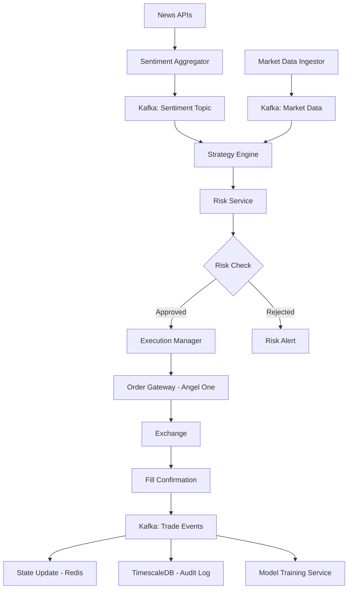

# HFT Complete Architecture Design

## 🏗️ **COMPREHENSIVE SYSTEM ARCHITECTURE**

Based on your existing `server/src/` structure and your HFT master plan requirements.

---

## 📁 **FINAL ARCHITECTURE STRUCTURE**

```
server/
├── src/
│   ├── 🚀 angel_one_api/              # EXISTING - Order Gateway/Execution
│   │   ├── api/                       # FastAPI routers & middleware
│   │   ├── methods/                   # 28 Angel One API methods
│   │   ├── rate_limiter/              # Distributed rate control
│   │   ├── auth/                      # JWT authentication
│   │   ├── database/                  # Database models
│   │   ├── messaging/                 # RabbitMQ integration
│   │   └── logger/                    # Enterprise logging
│   │
│   ├── 📊 market_data_ingestor/       # NEW - Market Data Ingestor
│   │   ├── __init__.py
│   │   ├── udp_receiver.py           # UDP market feeds
│   │   ├── tcp_backup.py             # TCP fallback
│   │   ├── normalizer.py             # Data standardization
│   │   ├── tick_store.py             # Short-term in-memory store
│   │   ├── kafka_publisher.py        # Kafka streaming
│   │   ├── latency_monitor.py        # Sub-millisecond monitoring
│   │   └── feed_manager.py           # Multi-feed coordination
│   │
│   ├── 🧠 execution_manager/          # NEW - Smart Router & Execution Manager
│   │   ├── __init__.py
│   │   ├── smart_router.py           # Order routing logic
│   │   ├── order_slicer.py           # TWAP, VWAP, IOC handling
│   │   ├── execution_engine.py       # Microsecond-optimized execution
│   │   ├── fill_tracker.py           # Execution confirmations
│   │   ├── latency_optimizer.py      # Ultra-low latency paths
│   │   └── queue_manager.py          # Low-latency queue management
│   │
│   ├── 🤖 ai/                         # EXISTING - Strategy Engines (Enhanced)
│   │   ├── strategy_engines/          # NEW - Stateless strategy workers
│   │   │   ├── __init__.py
│   │   │   ├── base_strategy_engine.py
│   │   │   ├── momentum_engine.py
│   │   │   ├── mean_reversion_engine.py
│   │   │   ├── arbitrage_engine.py
│   │   │   └── ml_strategy_engine.py
│   │   ├── central_ai_engine.py       # EXISTING - Enhanced
│   │   ├── pattern_recognition/       # EXISTING
│   │   ├── risk_management/           # EXISTING
│   │   ├── volatility_analysis/       # EXISTING
│   │   └── reinforcement/             # EXISTING
│   │
│   ├── 🛡️ risk_service/               # NEW - Risk & Compliance Service
│   │   ├── __init__.py
│   │   ├── pre_trade_checks.py       # Synchronous risk gate
│   │   ├── position_limits.py        # Position & loss limits
│   │   ├── market_risk.py            # VaR, correlation analysis
│   │   ├── compliance.py             # Regulatory checks
│   │   ├── circuit_breakers.py       # Emergency stops
│   │   ├── kill_switch.py            # Emergency kill-switch
│   │   └── api.py                    # FastAPI risk endpoints
│   │
│   ├── 🧪 model_training_service/     # NEW - GARDS/ML Training
│   │   ├── __init__.py
│   │   ├── training_pipeline.py      # Automated ML training
│   │   ├── feature_store.py          # Centralized features
│   │   ├── model_registry.py         # MLflow integration
│   │   ├── validation.py             # Walk-forward validation
│   │   ├── deployment.py             # Model deployment
│   │   ├── onnx_converter.py         # ONNX model conversion
│   │   └── cluster_training.py       # Dask/Ray distributed training
│   │
│   ├── 🔬 backtesting_platform/       # NEW - Backtester & Research
│   │   ├── __init__.py
│   │   ├── vectorbt_engine.py        # Fast vectorized backtests
│   │   ├── backtrader_engine.py      # Event-driven simulation
│   │   ├── strategy_screener.py      # Multi-strategy testing
│   │   ├── slippage_models.py        # Transaction cost modeling
│   │   ├── performance_analytics.py  # Sharpe, drawdown metrics
│   │   ├── historical_loader.py      # 10-year data loading
│   │   └── research_platform.py      # Research interface
│   │
│   ├── 📰 sentiment_aggregator/       # NEW - Sentiment & News
│   │   ├── __init__.py
│   │   ├── news_apis/               # Multi-source news ingestion
│   │   │   ├── newsapi_client.py
│   │   │   ├── newsdata_client.py
│   │   │   ├── webz_client.py
│   │   │   └── rss_feeds.py
│   │   ├── social_feeds/            # Social media streams
│   │   │   ├── twitter_stream.py
│   │   │   ├── reddit_scraper.py
│   │   │   └── stocktwits_api.py
│   │   ├── nlp_pipeline/            # NLP processing
│   │   │   ├── entity_linking.py
│   │   │   ├── sentiment_model.py
│   │   │   ├── distilbert_fine.py
│   │   │   └── confidence_scorer.py
│   │   ├── aggregator.py            # Main aggregation logic
│   │   └── signal_publisher.py      # Sentiment signal distribution
│   │
│   ├── 💾 data_infrastructure/        # NEW - State/Cache & Time-Series DB
│   │   ├── __init__.py
│   │   ├── redis_manager.py          # Fast state & ephemeral counters
│   │   ├── timescaledb_manager.py    # Time-series database
│   │   ├── clickhouse_manager.py     # High-ingest columnar store
│   │   ├── cache_layer.py            # Multi-tier caching
│   │   ├── data_lineage.py           # Data provenance tracking
│   │   └── backup_manager.py         # Data backup & recovery
│   │
│   ├── 📡 messaging_enhanced/         # ENHANCED - Message Bus & Event Layer
│   │   ├── __init__.py
│   │   ├── kafka/                   # NEW - High-throughput streams
│   │   │   ├── __init__.py
│   │   │   ├── producers/
│   │   │   │   ├── market_data_producer.py
│   │   │   │   ├── trade_events_producer.py
│   │   │   │   └── sentiment_producer.py
│   │   │   ├── consumers/
│   │   │   │   ├── strategy_consumer.py
│   │   │   │   ├── execution_consumer.py
│   │   │   │   └── analytics_consumer.py
│   │   │   ├── schemas/              # Avro/Protobuf schemas
│   │   │   │   ├── market_tick.avsc
│   │   │   │   ├── trade_order.avsc
│   │   │   │   ├── sentiment_signal.avsc
│   │   │   │   └── execution_event.avsc
│   │   │   └── cluster_manager.py
│   │   ├── rabbitmq/                # EXISTING - Control messages
│   │   │   ├── __init__.py
│   │   │   ├── connection.py
│   │   │   ├── publisher.py
│   │   │   └── consumer.py
│   │   └── grpc/                    # NEW - Low-latency binary protocols
│   │       ├── __init__.py
│   │       ├── risk_service.proto
│   │       ├── execution_service.proto
│   │       └── generated/
│   │
│   ├── 📊 observability/              # NEW - Monitoring & Observability
│   │   ├── __init__.py
│   │   ├── prometheus/              # Metrics collection
│   │   │   ├── metrics_collector.py
│   │   │   ├── custom_metrics.py
│   │   │   └── exporters.py
│   │   ├── jaeger/                  # Distributed tracing
│   │   │   ├── tracer_setup.py
│   │   │   ├── spans.py
│   │   │   └── trace_analysis.py
│   │   ├── grafana/                 # Dashboards
│   │   │   ├── dashboard_configs/
│   │   │   └── alert_rules.yml
│   │   ├── elk/                     # Centralized logging
│   │   │   ├── logstash_config.py
│   │   │   ├── elasticsearch_setup.py
│   │   │   └── kibana_dashboards.py
│   │   └── health_monitor.py        # System health monitoring
│   │
│   ├── 🐳 deployment/                 # NEW - Container Orchestration
│   │   ├── docker/
│   │   │   ├── dockerfiles/
│   │   │   │   ├── Dockerfile.angel_one_api
│   │   │   │   ├── Dockerfile.market_data_ingestor
│   │   │   │   ├── Dockerfile.execution_manager
│   │   │   │   ├── Dockerfile.risk_service
│   │   │   │   ├── Dockerfile.sentiment_aggregator
│   │   │   │   └── Dockerfile.backtesting_platform
│   │   │   └── docker-compose.yml
│   │   ├── kubernetes/
│   │   │   ├── namespaces/
│   │   │   ├── deployments/
│   │   │   ├── services/
│   │   │   ├── configmaps/
│   │   │   └── secrets/
│   │   └── helm/
│   │       ├── charts/
│   │       └── values/
│   │
│   ├── 🧪 testing_framework/          # NEW - Comprehensive Testing
│   │   ├── __init__.py
│   │   ├── unit_tests/              # Component-level tests
│   │   ├── integration_tests/        # Service integration tests
│   │   ├── chaos_engineering/        # Failure injection tests
│   │   ├── load_tests/              # Performance & stress tests
│   │   ├── replay_tests/            # Historical replay validation
│   │   ├── paper_trading/           # Paper trading simulation
│   │   └── emergency_tests/         # Kill-switch & emergency procedures
│   │
│   ├── ml/                           # EXISTING - Enhanced ML
│   ├── strategies/                   # EXISTING - Enhanced Strategies
│   ├── core/                         # EXISTING - Enhanced Core
│   └── docs/                         # EXISTING - Enhanced Documentation
│
└── requirements.txt                  # ENHANCED - All dependencies
```

---

## 🔄 **TRADE EXECUTION FLOW (Your Exact Specification)**

### **Complete Flow Architecture:**



### **Step-by-Step Flow:**

1. **News Aggregator** tags stock "X" positive sentiment → publishes to **Kafka sentiment topic**
2. **Strategy Engine** subscribes to sentiment + market feeds → runs feature computation
3. **Strategy Engine** asks **Risk Service** for permission (gRPC sync call)
4. If approved → sends order intent to **Execution Manager** via low-latency queue
5. **Execution Manager** creates child orders → sends to **Angel One API** via optimized queue
6. **Angel One** executes → fills/acks flow back via **Kafka trade events**
7. **Execution Manager** updates state in **Redis** and logs to **TimescaleDB**
8. Post-trade: P&L calculated, alerts sent, **Model Training Service** gets new data

---

## 📋 **MESSAGE SCHEMAS (Avro/Protobuf)**

### **Market Tick Schema (market_tick.avsc):**
```json
{
  "type": "record",
  "name": "MarketTick",
  "fields": [
    {"name": "symbol", "type": "string"},
    {"name": "timestamp", "type": "long"},
    {"name": "price", "type": "double"},
    {"name": "volume", "type": "long"},
    {"name": "bid", "type": "double"},
    {"name": "ask", "type": "double"},
    {"name": "exchange", "type": "string"},
    {"name": "feed_latency_ns", "type": "long"}
  ]
}
```

### **Trade Order Schema (trade_order.avsc):**
```json
{
  "type": "record",
  "name": "TradeOrder",
  "fields": [
    {"name": "order_id", "type": "string"},
    {"name": "strategy_id", "type": "string"},
    {"name": "symbol", "type": "string"},
    {"name": "side", "type": {"type": "enum", "symbols": ["BUY", "SELL"]}},
    {"name": "quantity", "type": "long"},
    {"name": "price", "type": "double"},
    {"name": "order_type", "type": {"type": "enum", "symbols": ["MARKET", "LIMIT", "STOP"]}},
    {"name": "timestamp", "type": "long"},
    {"name": "risk_approved", "type": "boolean"},
    {"name": "execution_venue", "type": "string"}
  ]
}
```

### **Sentiment Signal Schema (sentiment_signal.avsc):**
```json
{
  "type": "record",
  "name": "SentimentSignal",
  "fields": [
    {"name": "symbol", "type": "string"},
    {"name": "sentiment_score", "type": "double"},
    {"name": "confidence", "type": "double"},
    {"name": "source", "type": "string"},
    {"name": "timestamp", "type": "long"},
    {"name": "news_headline", "type": ["null", "string"]},
    {"name": "social_mentions", "type": "int"},
    {"name": "provenance", "type": "string"}
  ]
}
```

---

## ⚡ **TECHNOLOGY STACK MAPPING**

### **Infrastructure:**
- **Orchestration**: Docker + Kubernetes
- **Service Mesh**: Istio (for service-to-service communication)
- **Load Balancing**: NGINX + HAProxy

### **Messaging & Streaming:**
- **Kafka**: Market data streams, trade events, sentiment signals
- **RabbitMQ**: Control messages, configuration updates (existing)
- **gRPC**: Risk service, execution manager (low-latency binary)

### **Data Storage:**
- **Redis**: Fast state, ephemeral counters, session data
- **TimescaleDB**: Time-series data, trade logs, market history
- **ClickHouse**: High-ingest analytics, backtesting data
- **MongoDB**: Configuration, user data (existing)

### **Backtesting:**
- **vectorbt**: Large-scale vectorized backtests (10-year datasets)
- **Backtrader**: Event-driven realistic simulation (your requirement)
- **Zipline**: Alternative event-driven (if needed)

### **ML Infrastructure:**
- **Dask/Ray**: Distributed training clusters
- **MLflow**: Model registry, experiment tracking
- **ONNX**: Model deployment & optimization
- **Triton**: High-performance model serving

### **Monitoring:**
- **Prometheus**: Metrics collection
- **Grafana**: Dashboards & visualization
- **Jaeger**: Distributed tracing
- **ELK Stack**: Centralized logging

---

## 🎯 **LATENCY OPTIMIZATION STRATEGY**

### **Critical Path (Sub-millisecond targets):**
1. **Market Data Ingestor**: UDP multicast → C++ optimized receiver
2. **Risk Service**: Pre-compiled rules → gRPC binary protocol
3. **Execution Manager**: Memory-mapped queues → FPGA acceleration
4. **Angel One API**: Connection pooling → TCP_NODELAY optimization

### **Non-Critical Path (Keep Python):**
1. **Strategy Engines**: Complex ML inference (10-100ms acceptable)
2. **Sentiment Analysis**: NLP processing (seconds acceptable)
3. **Backtesting**: Historical analysis (minutes/hours acceptable)
4. **Model Training**: Offline training (hours/days acceptable)

---

## 📊 **SCALABILITY DESIGN**

### **Horizontal Scaling:**
- **Strategy Engines**: Stateless workers with auto-scaling
- **Market Data Ingestor**: Sharded by symbol/exchange
- **Sentiment Aggregator**: Parallel news source processing
- **Model Training**: Distributed across compute clusters

### **Vertical Scaling:**
- **Risk Service**: High-memory instances for large portfolios
- **Execution Manager**: High-CPU instances for order optimization
- **TimescaleDB**: High-IOPS storage for time-series data
- **Redis**: Memory-optimized instances for state management

---

This architecture perfectly integrates your existing Angel One FastAPI system with the complete HFT requirements while maintaining your current investments and adding the missing components systematically.

**Ready to proceed with the 8-week implementation roadmap?** 🚀
