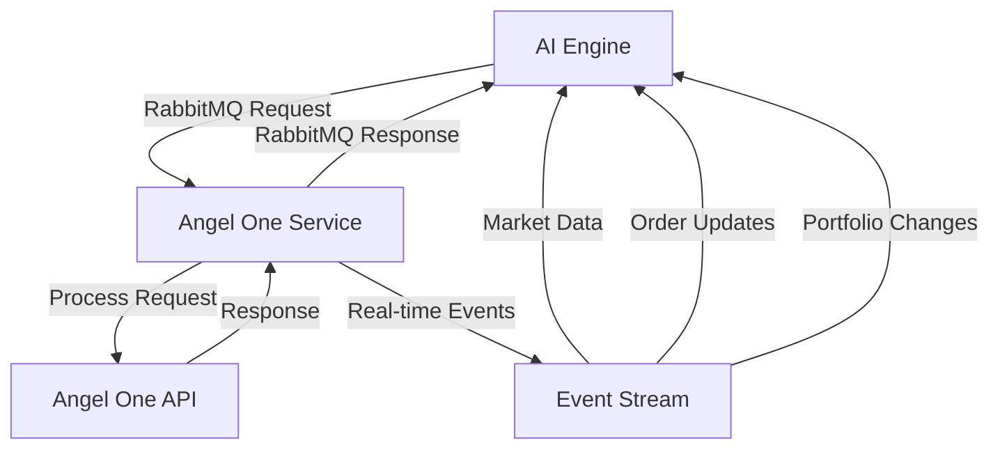
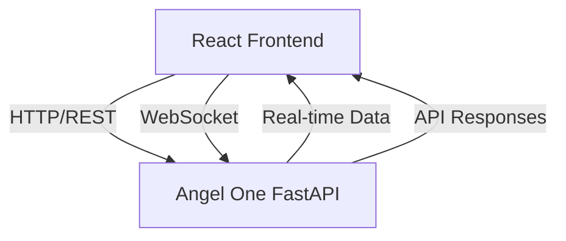
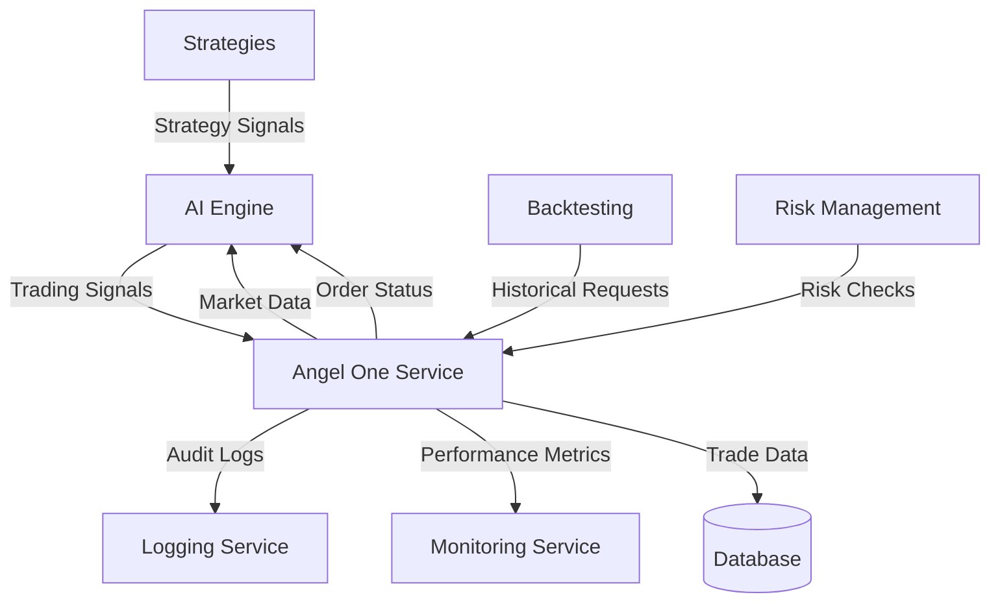

# Angel One Microservice Architecture Plan
## 🚀 **HFT AUTOMATED AI TRADING ENGINE INTEGRATION**

**Version**: 1.0.0  
**Date**: 2025-09-20  
**Author**: AI Trading System  
**Status**: ARCHITECTURE PROPOSAL  

---

## 🏗️ **CURRENT ECOSYSTEM ANALYSIS**

### **EXISTING MICROSERVICES STRUCTURE**
```
Finance Server/server/src/
├── 🤖 ai/                     # AI Engine & Models
├── 🤖 ai_models/              # AI Model Storage
├── 🔵 angel_one_api/          # ⭐ OUR TARGET MODULE
├── 🌐 api_gateway/            # API Gateway Service
├── 📊 backtesting/            # Backtesting Engine
├── 📊 backtesting_framework/  # Advanced Backtesting
├── ⚙️ config/                 # Configuration Service
├── 🔧 core/                   # Core Utilities
├── 🗄️ database/               # Database Service
├── 📈 data_ingestion/         # Data Pipeline Service
├── 📚 docs/                   # Documentation
├── 📊 indicators/             # Technical Indicators
├── 📋 logging/                # Logging Service
├── 📋 log_system/             # Log Management
├── 🤖 ml/                     # Machine Learning Service
├── 📡 monitoring/             # System Monitoring
├── 🎭 orchestration/          # Service Orchestration
├── 📦 order_management/       # Order Management Service
├── 🔧 services/               # Shared Services
├── 🧠 strategies/             # Trading Strategies
├── 🧪 testing/                # Testing Framework
└── 💹 trading/                # Trading Engine
```

### **INTEGRATION CHALLENGE**
Transform `angel_one_api/` from a **module** into a **microservice** that communicates with the entire HFT ecosystem via **RabbitMQ**.

---

## 🎯 **PROPOSED ANGEL ONE MICROSERVICE ARCHITECTURE**

### **🔧 FASTAPI SERVER STRUCTURE**
```
angel_one_api/
├── 📁 api/                    # FastAPI Application
│   ├── __init__.py
│   ├── main.py               # FastAPI app entry point
│   ├── dependencies.py       # Shared dependencies
│   ├── middleware.py         # Custom middleware
│   └── routers/              # API Endpoints
│       ├── __init__.py
│       ├── authentication.py  # Auth endpoints
│       ├── trading.py         # Trading endpoints
│       ├── market_data.py     # Market data endpoints
│       ├── portfolio.py       # Portfolio endpoints
│       ├── risk.py           # Risk management endpoints
│       ├── advanced.py       # Advanced features
│       ├── admin.py          # Admin endpoints
│       └── websockets.py     # WebSocket handlers
├── 📁 messaging/              # RabbitMQ Integration
│   ├── __init__.py
│   ├── publisher.py          # Message publishing
│   ├── consumer.py           # Message consumption
│   ├── handlers.py           # Message handlers
│   └── schemas.py            # Message schemas
├── 📁 services/              # Business Logic (existing enhanced)
│   ├── authentication/       # (existing)
│   ├── market_data/          # (existing)
│   ├── portfolio/            # (existing)
│   ├── fund_management/      # (existing)
│   ├── reports/              # (existing)
│   └── alerts/               # (existing)
├── 📁 methods/               # (existing - 28 API methods)
├── 📁 rate_limiter/          # (existing - enhanced for microservice)
├── 📁 logger/                # (existing - enhanced)
├── 📁 models/                # Pydantic Models
│   ├── __init__.py
│   ├── requests.py           # Request models
│   ├── responses.py          # Response models
│   └── internal.py           # Internal models
├── 📁 config/                # Configuration
│   ├── __init__.py
│   ├── settings.py           # Application settings
│   └── rabbitmq.py          # RabbitMQ configuration
└── 📁 tests/                 # Testing (existing enhanced)
```

---

## 🌐 **FASTAPI ENDPOINTS SPECIFICATION**

### **🔐 AUTHENTICATION ENDPOINTS**
| Method | Endpoint | Description | Type | Real-time |
|--------|----------|-------------|------|-----------|
| `POST` | `/auth/configure` | Configure API keys | REST | ❌ |
| `POST` | `/auth/login` | Login all keys | REST | ❌ |
| `GET` | `/auth/status` | Auth status | REST | ❌ |
| `POST` | `/auth/refresh` | Refresh tokens | REST | ❌ |
| `POST` | `/auth/logout` | Logout session | REST | ❌ |

### **💹 TRADING ENDPOINTS**
| Method | Endpoint | Description | Type | Real-time |
|--------|----------|-------------|------|-----------|
| `POST` | `/trading/orders` | Place order | REST | ❌ |
| `PUT` | `/trading/orders/{order_id}` | Modify order | REST | ❌ |
| `DELETE` | `/trading/orders/{order_id}` | Cancel order | REST | ❌ |
| `GET` | `/trading/orders` | Get order book | REST | ❌ |
| `GET` | `/trading/orders/{order_id}` | Order details | REST | ❌ |
| `GET` | `/trading/trades` | Get trade book | REST | ❌ |
| `POST` | `/trading/positions/convert` | Convert position | REST | ❌ |
| `WS` | `/ws/trading/orders` | **Real-time order updates** | WebSocket | ✅ |

### **📊 MARKET DATA ENDPOINTS**
| Method | Endpoint | Description | Type | Real-time |
|--------|----------|-------------|------|-----------|
| `GET` | `/market/ltp/{symbol}` | Get LTP | REST | ❌ |
| `POST` | `/market/ltp/bulk` | Bulk LTP | REST | ❌ |
| `GET` | `/market/search` | Search instruments | REST | ❌ |
| `GET` | `/market/candles` | Historical data | REST | ❌ |
| `GET` | `/market/quote/{symbol}` | Market quote | REST | ❌ |
| `GET` | `/market/status` | Market status | REST | ❌ |
| `GET` | `/market/gainers-losers` | Top gainers/losers | REST | ❌ |
| `WS` | `/ws/market/ltp` | **Real-time LTP stream** | WebSocket | ✅ |
| `WS` | `/ws/market/quotes` | **Real-time quotes** | WebSocket | ✅ |

### **💰 PORTFOLIO ENDPOINTS**
| Method | Endpoint | Description | Type | Real-time |
|--------|----------|-------------|------|-----------|
| `GET` | `/portfolio/positions` | Get positions | REST | ❌ |
| `GET` | `/portfolio/holdings` | Get holdings | REST | ❌ |
| `GET` | `/portfolio/holdings/all` | All holdings analysis | REST | ❌ |
| `GET` | `/portfolio/summary` | Portfolio summary | REST | ❌ |
| `GET` | `/portfolio/pnl` | P&L report | REST | ❌ |
| `GET` | `/portfolio/performance` | Performance metrics | REST | ❌ |
| `WS` | `/ws/portfolio/updates` | **Real-time portfolio updates** | WebSocket | ✅ |

### **⚠️ RISK MANAGEMENT ENDPOINTS**
| Method | Endpoint | Description | Type | Real-time |
|--------|----------|-------------|------|-----------|
| `GET` | `/risk/rms` | RMS limits | REST | ❌ |
| `POST` | `/risk/margin/calculate` | Margin calculation | REST | ❌ |
| `POST` | `/risk/margin/batch` | Batch margin | REST | ❌ |
| `GET` | `/risk/profile` | Risk profile | REST | ❌ |
| `GET` | `/risk/alerts` | Risk alerts | REST | ❌ |

### **🎯 ADVANCED FEATURES ENDPOINTS**
| Method | Endpoint | Description | Type | Real-time |
|--------|----------|-------------|------|-----------|
| `POST` | `/advanced/gtt` | Create GTT rule | REST | ❌ |
| `PUT` | `/advanced/gtt/{rule_id}` | Modify GTT rule | REST | ❌ |
| `DELETE` | `/advanced/gtt/{rule_id}` | Cancel GTT rule | REST | ❌ |
| `GET` | `/advanced/gtt` | List GTT rules | REST | ❌ |
| `GET` | `/advanced/gtt/{rule_id}` | GTT rule details | REST | ❌ |
| `POST` | `/advanced/option-greeks` | Option Greeks | REST | ❌ |
| `POST` | `/advanced/tokens/generate` | Generate tokens | REST | ❌ |

### **👨‍💼 ADMIN & MONITORING ENDPOINTS**
| Method | Endpoint | Description | Type | Real-time |
|--------|----------|-------------|------|-----------|
| `GET` | `/admin/health` | Health check | REST | ❌ |
| `GET` | `/admin/stats` | Service statistics | REST | ❌ |
| `GET` | `/admin/rate-limits` | Rate limit status | REST | ❌ |
| `POST` | `/admin/rate-limits/reset` | Reset emergency brake | REST | ❌ |
| `GET` | `/admin/logs` | Log statistics | REST | ❌ |
| `WS` | `/ws/admin/monitoring` | **Real-time monitoring** | WebSocket | ✅ |

---

## 🔌 **WEBSOCKET ENDPOINTS FOR REAL-TIME DATA**

### **🚀 HIGH-FREQUENCY TRADING WEBSOCKETS**
```python
# Real-time LTP streaming for AI engine
WS: /ws/market/ltp
- Subscribe to multiple symbols
- Real-time price updates (50/sec per symbol)
- Automatic reconnection
- Buffering for missed messages

# Real-time order status for AI monitoring  
WS: /ws/trading/orders
- Order placement confirmations
- Fill notifications
- Rejection alerts
- Position updates

# Real-time portfolio monitoring
WS: /ws/portfolio/updates
- Live P&L updates
- Position changes
- Risk threshold alerts
- Performance metrics

# System monitoring for ops team
WS: /ws/admin/monitoring  
- Rate limit utilization
- API health status
- Error rate monitoring
- Performance metrics
```

---

## 🐰 **RABBITMQ MESSAGE ARCHITECTURE**

### **MESSAGE QUEUES DESIGN**
```
RabbitMQ Exchanges:
├── 📨 angel.direct         # Direct routing
├── 📊 angel.topic          # Topic-based routing  
├── 🔔 angel.fanout         # Broadcast messages
└── 💀 angel.dlx            # Dead letter exchange

Key Queues:
├── 🤖 ai.requests          # AI → Angel One requests
├── 🤖 ai.responses         # Angel One → AI responses
├── 📊 market.data          # Market data broadcasts
├── 💹 trading.events       # Trading events
├── 📈 portfolio.updates    # Portfolio changes
├── ⚠️ risk.alerts          # Risk management alerts
├── 📋 audit.logs           # Audit trail
└── 🚨 system.alerts        # System notifications
```

### **MESSAGE SCHEMAS**

#### **AI REQUEST MESSAGES**
```python
# AI Engine requesting market data
{
    "message_type": "market_data_request",
    "request_id": "uuid",
    "timestamp": "2025-09-20T10:30:00Z",
    "symbols": ["RELIANCE", "TCS", "INFY"],
    "data_type": "ltp|quote|candles",
    "params": {
        "interval": "1minute",
        "from_date": "2025-09-20",
        "to_date": "2025-09-20"
    },
    "priority": "high|medium|low",
    "callback_queue": "ai.responses"
}

# AI Engine placing order
{
    "message_type": "place_order",
    "request_id": "uuid", 
    "timestamp": "2025-09-20T10:30:00Z",
    "order": {
        "symbol": "RELIANCE",
        "quantity": 100,
        "transaction_type": "BUY",
        "order_type": "MARKET",
        "product": "INTRADAY",
        "price": 2500.0
    },
    "risk_params": {
        "max_loss": 1000,
        "position_size_limit": 10000
    }
}
```

#### **ANGEL ONE RESPONSE MESSAGES**
```python
# Market data response
{
    "message_type": "market_data_response",
    "request_id": "uuid",
    "timestamp": "2025-09-20T10:30:00Z",
    "success": true,
    "data": {
        "RELIANCE": {
            "ltp": 2485.50,
            "change": -14.50,
            "change_pct": -0.58,
            "volume": 1234567
        }
    },
    "latency_ms": 45
}

# Order placement response
{
    "message_type": "order_response",
    "request_id": "uuid",
    "timestamp": "2025-09-20T10:30:00Z", 
    "success": true,
    "order_id": "240920001234567",
    "status": "COMPLETE|PENDING|REJECTED",
    "filled_quantity": 100,
    "average_price": 2485.50,
    "message": "Order placed successfully"
}
```

### **REAL-TIME EVENT STREAMS**
```python
# Real-time price updates (broadcast)
{
    "message_type": "price_update",
    "timestamp": "2025-09-20T10:30:00Z",
    "symbol": "RELIANCE", 
    "ltp": 2485.50,
    "change": -14.50,
    "volume": 1234567,
    "market": "NSE"
}

# Portfolio update events
{
    "message_type": "portfolio_update",
    "timestamp": "2025-09-20T10:30:00Z",
    "account_id": "account_123",
    "type": "position_change|pnl_update",
    "data": {
        "symbol": "RELIANCE",
        "quantity": 100,
        "average_price": 2485.50,
        "current_price": 2487.00,
        "pnl": 150.00
    }
}
```

---

## 🔧 **IMPLEMENTATION ROADMAP**

### **PHASE 1: CORE FASTAPI SERVICE (Week 1-2)**
1. **✅ Setup FastAPI Application**
   - Create FastAPI app structure
   - Implement basic authentication endpoints
   - Add health checks and monitoring

2. **✅ Core Trading Endpoints**
   - Implement place/modify/cancel order endpoints
   - Add order book and trade book endpoints
   - Integrate with existing methods/

3. **✅ Market Data Endpoints**
   - LTP and quote endpoints
   - Historical data endpoints
   - Instrument search endpoints

### **PHASE 2: RABBITMQ INTEGRATION (Week 2-3)**
1. **✅ Message Infrastructure**
   - RabbitMQ connection management
   - Message publishing and consuming
   - Dead letter queue handling

2. **✅ AI Communication Protocol**
   - Request/response message schemas
   - Event streaming for real-time data
   - Error handling and retries

### **PHASE 3: WEBSOCKET IMPLEMENTATION (Week 3-4)**
1. **✅ Real-time Data Streaming**
   - LTP streaming via WebSocket
   - Order status streaming
   - Portfolio update streaming

2. **✅ Performance Optimization**
   - Connection pooling
   - Message buffering
   - Latency optimization

### **PHASE 4: FRONTEND INTEGRATION (Week 4-5)**
1. **✅ React Application Setup**
   - Create React testing dashboard
   - Implement API integration
   - WebSocket connections

2. **✅ Testing Interface**
   - Complete endpoint testing
   - Real-time data visualization
   - Performance monitoring

### **PHASE 5: PRODUCTION DEPLOYMENT (Week 5-6)**
1. **✅ Container Setup**
   - Docker containerization
   - Kubernetes deployment
   - Service mesh integration

2. **✅ Monitoring & Logging**
   - Enhanced logging integration
   - Metrics collection
   - Alerting system

---

## 🎯 **COMMUNICATION FLOW ARCHITECTURE**

### **AI ENGINE ↔ ANGEL ONE SERVICE**


### **FRONTEND ↔ ANGEL ONE SERVICE**


### **MICROSERVICE ECOSYSTEM**


---

## 📊 **PERFORMANCE TARGETS**

### **LATENCY REQUIREMENTS**
- **REST API Response**: < 100ms average
- **WebSocket Message Delivery**: < 50ms
- **RabbitMQ Message Processing**: < 20ms
- **AI Request Processing**: < 200ms end-to-end

### **THROUGHPUT TARGETS**
- **API Endpoints**: 1000 requests/second
- **WebSocket Connections**: 100 concurrent clients
- **RabbitMQ Messages**: 5000 messages/second
- **Real-time Data Stream**: 50 updates/second per symbol

### **AVAILABILITY TARGETS**
- **Service Uptime**: 99.9%
- **API Availability**: 99.95%
- **Message Delivery**: 99.99%
- **Data Consistency**: 100%

---

## 🔒 **SECURITY & COMPLIANCE**

### **API SECURITY**
- **Authentication**: JWT tokens with refresh
- **Authorization**: Role-based access control
- **Rate Limiting**: Per-endpoint and global limits
- **Input Validation**: Pydantic models for all requests

### **MESSAGE SECURITY**
- **Message Encryption**: TLS for RabbitMQ
- **Message Signing**: HMAC verification
- **Access Control**: Queue-level permissions
- **Audit Trail**: Complete message logging

### **COMPLIANCE**
- **Trading Regulations**: All trades logged and auditable
- **Data Privacy**: Sensitive data encryption
- **Risk Management**: Real-time risk monitoring
- **Disaster Recovery**: Multi-region failover

---

This architecture transforms your Angel One module into a production-ready microservice that seamlessly integrates with your HFT ecosystem while maintaining the existing functionality and adding powerful new capabilities for AI-driven trading.


