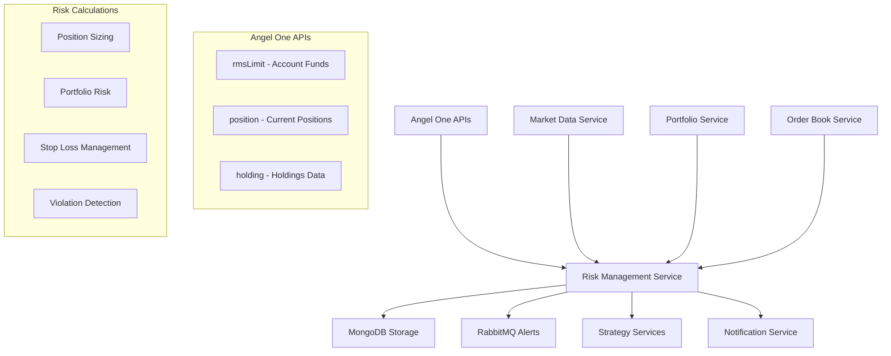

# 🛡️ Risk Management Service - Data Flow & Integration

## 🔄 **HOW IT WORKS - COMPLETE DATA FLOW**

### **📊 Data Sources & Integration**



## 📈 **DATA SOURCES EXPLAINED**

### **1. Angel One API Data (Primary Source)**
```python
# Real-time account data
smart_connect.rmsLimit()    # Account balance, available cash, margin
smart_connect.position()    # Current open positions with P&L
smart_connect.holding()     # Long-term holdings (via Portfolio Service)
```

### **2. Market Data Integration**
```python
# Current prices for risk calculations
smart_connect.ltpData()     # Last traded price for positions
smart_connect.getMarketData() # Complete market data (via Market Data Service)
```

### **3. Internal Service Data**
```python
# From other microservices
Portfolio Service → Holdings & position details
Order Book Service → Recent orders & trade history
Strategy Services → Planned trades & signals
```

## 🧮 **RISK CALCULATIONS EXPLAINED**

### **Position Sizing Algorithm**
```python
def calculate_position_size(symbol, entry_price, stop_loss_price, account_balance):
    """
    How it works:
    1. Get account balance from Angel One rmsLimit API
    2. Calculate risk per share = |entry_price - stop_loss_price|
    3. Apply risk management rules:
       - Max 2% of portfolio risk per trade
       - Max 10% of portfolio per position
    4. Return recommended position size
    """
    
    # Example calculation:
    entry_price = 2500.0
    stop_loss_price = 2400.0
    account_balance = 100000.0
    
    risk_per_share = 2500 - 2400 = 100
    max_risk_amount = 100000 * 0.02 = 2000  # 2% max risk
    max_shares_by_risk = 2000 / 100 = 20 shares
    
    max_position_value = 100000 * 0.10 = 10000  # 10% max position
    max_shares_by_position = 10000 / 2500 = 4 shares
    
    # Take the smaller limit for safety
    recommended_shares = min(20, 4) = 4 shares
    
    # Result: 4 shares, ₹10,000 investment, 0.40% portfolio risk
```

### **Portfolio Risk Assessment**
```python
def calculate_portfolio_risk():
    """
    Real-time portfolio analysis:
    1. Fetch all current positions from Angel One
    2. Get current market prices
    3. Calculate total investment, P&L, exposure
    4. Check against risk limits
    5. Generate violation alerts if needed
    """
    
    # Example portfolio analysis:
    positions = smart_connect.position()  # Get live positions
    account_funds = smart_connect.rmsLimit()  # Get available funds
    
    total_investment = 0
    total_pnl = 0
    
    for position in positions:
        quantity = position['netqty']
        avg_price = position['avgprice']
        current_price = position['ltp']
        
        investment = abs(quantity) * avg_price
        pnl = quantity * (current_price - avg_price)
        
        total_investment += investment
        total_pnl += pnl
    
    # Check violations
    investment_percentage = (total_investment / account_balance) * 100
    daily_pnl_percentage = (total_pnl / account_balance) * 100
    
    if daily_pnl_percentage < -5:  # 5% daily loss limit
        trigger_risk_alert("Daily loss limit exceeded")
```

## 🚨 **RISK VIOLATION DETECTION**

### **Automatic Monitoring System**
```python
# Risk violations checked in real-time:

1. Daily Loss Limit: -5% (configurable)
   if daily_pnl_percentage < -5%:
       Alert: "STOP TRADING - Daily loss limit exceeded"

2. Position Size Limit: 10% per position
   if position_size > 10% of portfolio:
       Alert: "Reduce position size for {symbol}"

3. Over-Investment: 95% of capital deployed
   if total_investment > 95% of portfolio:
       Alert: "Portfolio over-invested - reduce exposure"

4. Concentration Risk: Too many positions in one sector
   Alert: "Diversification warning"
```

## 🔄 **REAL-TIME DATA FLOW**

### **Continuous Monitoring Loop**
```python
# How the service monitors in real-time:

1. Every 30 seconds (configurable):
   ↓
2. Fetch latest positions from Angel One API
   ↓
3. Get current market prices
   ↓
4. Calculate portfolio risk metrics
   ↓
5. Check for violations
   ↓
6. If violations found:
   → Store in MongoDB
   → Send RabbitMQ alert
   → Notify other services
   ↓
7. Update risk dashboard
   ↓
8. Sleep and repeat
```

## 📡 **SERVICE INTEGRATION**

### **How Other Services Use Risk Management**

#### **Strategy Services Integration**
```python
# Before placing any trade:
strategy_service = StrategyService()
risk_service = RiskManagementService()

# Strategy generates signal
signal = strategy_service.generate_signal("RELIANCE-EQ")

if signal == "BUY":
    # Check with risk management first
    position_calc = risk_service.calculate_position_size(
        symbol="RELIANCE-EQ",
        entry_price=2500.0,
        stop_loss_price=2400.0
    )
    
    if position_calc['status'] == 'success':
        recommended_shares = position_calc['recommended_shares']
        
        # Place order with risk-adjusted size
        order_service.place_order(
            symbol="RELIANCE-EQ",
            quantity=recommended_shares,  # Risk-managed quantity
            price=2500.0
        )
    else:
        logger.warning("Risk management rejected trade")
```

#### **Portfolio Service Integration**
```python
# Portfolio service provides holdings data to risk service
portfolio_data = portfolio_service.get_holdings()
risk_metrics = risk_service.calculate_portfolio_risk()

# Risk service checks portfolio-wide exposure
if risk_metrics['violations']:
    # Portfolio service can take action
    portfolio_service.rebalance_portfolio()
```

## 🎯 **AI INTEGRATION (Future Enhancement)**

### **Current Implementation**
- **Rule-Based Risk Management**: Uses predefined risk parameters
- **Real-Time Calculations**: Based on live market data
- **Violation Detection**: Threshold-based alerts

### **AI-Enhanced Risk (Planned)**
```python
# Future AI integration:

1. Machine Learning Risk Models:
   - Predict portfolio risk based on market conditions
   - Dynamic risk parameter adjustment
   - Correlation analysis between positions

2. Intelligent Position Sizing:
   - AI-optimized position sizes based on market volatility
   - Adaptive risk limits based on market regime
   - Sentiment-based risk adjustment

3. Predictive Risk Alerts:
   - Early warning system for potential violations
   - Market stress testing scenarios
   - AI-powered stop-loss optimization
```

## 💾 **DATA STORAGE & HISTORY**

### **MongoDB Collections**
```python
# Risk data stored for analysis:

risk_metrics: {
    "timestamp": "2025-09-13T14:30:00Z",
    "account_balance": 100000.0,
    "total_investment": 45000.0,
    "total_pnl": 2500.0,
    "investment_percentage": 45.0,
    "daily_pnl_percentage": 2.5,
    "violations": [],
    "position_risks": [...]
}

position_risks: {
    "symbol": "RELIANCE-EQ",
    "quantity": 10,
    "avg_price": 2450.0,
    "current_price": 2500.0,
    "investment": 24500.0,
    "pnl": 500.0,
    "risk_percentage": 1.8
}

stop_loss_orders: {
    "symbol": "RELIANCE-EQ",
    "quantity": 10,
    "trigger_price": 2400.0,
    "is_active": true,
    "created_at": "2025-09-13T14:00:00Z"
}
```

## 🎮 **PRACTICAL USAGE EXAMPLES**

### **Example 1: New Trade Risk Check**
```python
# Before placing a new trade
risk_service = RiskManagementService()

# Check if we can afford the risk
position_calc = risk_service.calculate_position_size(
    symbol='SBIN-EQ',
    entry_price=520.0,
    stop_loss_price=500.0,
    account_balance=50000.0
)

print(f"Recommended shares: {position_calc['recommended_shares']}")
print(f"Risk percentage: {position_calc['actual_risk_percentage']:.2f}%")
# Output: Recommended shares: 5, Risk percentage: 2.00%
```

### **Example 2: Portfolio Health Check**
```python
# Check current portfolio risk
portfolio_risk = risk_service.calculate_portfolio_risk()

if portfolio_risk['violations']:
    for violation in portfolio_risk['violations']:
        print(f"⚠️ Risk Alert: {violation['message']}")
        
        if violation['type'] == 'daily_loss_limit':
            # Stop all trading
            strategy_service.pause_all_strategies()
        elif violation['type'] == 'position_size_limit':
            # Reduce specific position
            symbol = violation['symbol']
            order_service.reduce_position(symbol, 50)  # Reduce by 50%
```

### **Example 3: Stop-Loss Management**
```python
# Create protective stop-loss
stop_loss = risk_service.create_stop_loss_order(
    symbol='RELIANCE-EQ',
    quantity=10,
    trigger_price=2400.0
)

# Monitor will automatically check if price hits stop-loss
monitoring = risk_service.monitor_positions()
for check in monitoring['stop_loss_checks']:
    if check['action'] == 'trigger_stop_loss':
        print(f"🛑 Stop-loss triggered for {check['symbol']}")
```

## 🏆 **KEY BENEFITS**

### **1. Automated Risk Control**
- No manual calculation needed
- Real-time risk assessment
- Automatic violation detection

### **2. Capital Protection**
- Maximum 2% risk per trade
- Portfolio-wide exposure limits
- Daily loss circuit breakers

### **3. Intelligent Position Sizing**
- Risk-adjusted trade sizes
- Account balance consideration
- Stop-loss distance optimization

### **4. Real-Time Monitoring**
- Continuous portfolio surveillance
- Instant violation alerts
- Proactive risk management

The Risk Management Service acts as the **"intelligent guardian"** of your trading system, ensuring every trade is properly sized and the overall portfolio risk stays within safe limits! 🛡️


